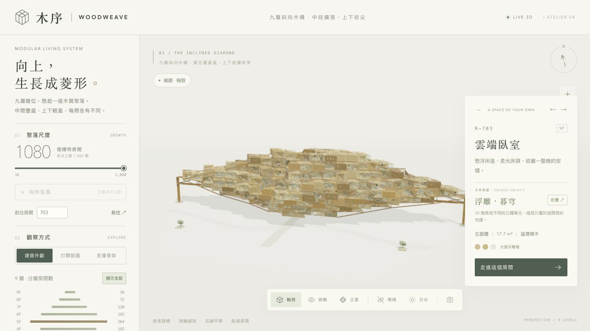
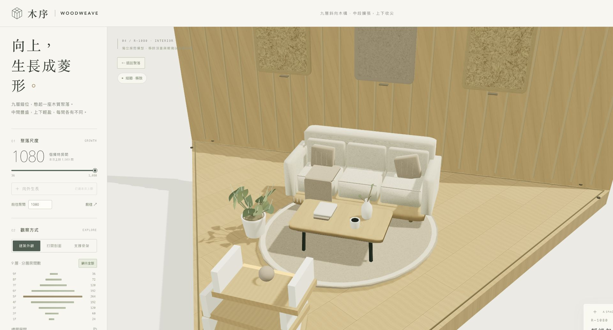
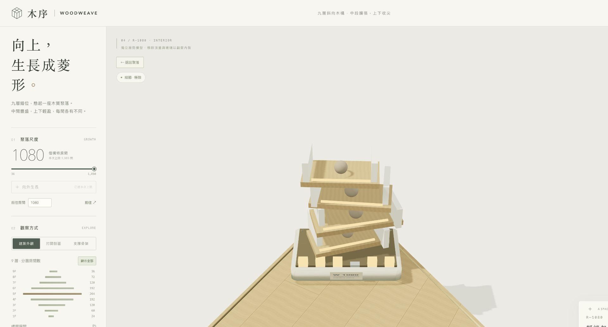
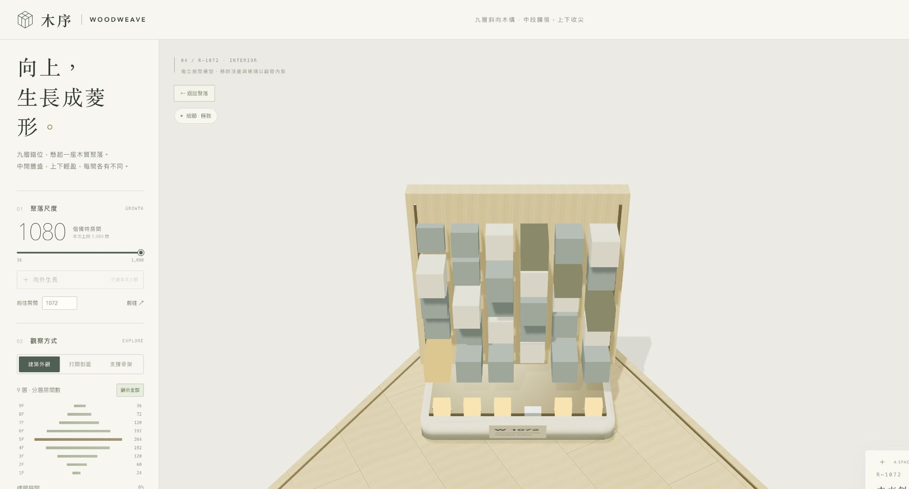

# Atelier 04 · 1,080 間高畫質驗證

2026-10-15，以 Apple M4 Pro、24 GB 記憶體的桌面瀏覽器實測。網頁視窗為 **1920 × 1080**，3D 區域為 **1617 × 1004**，極致模式繪圖解析度為 **3234 × 2008，像素倍率 2**。所有場景保留完整家具、木紋、木纖維板與羊毛氈；快速移動時也固定極致品質。

高解析度測試使用獨立本機副本，只把品質設定的裝置像素倍率輸入固定為 2，其他原始模組與正式版本一致。正式展示仍跟隨裝置的原生倍率、極致最高 2×。[測試方式與模組雜湊](docs/performance-retina-method.json)。另以未修改的正式單檔操作旋轉及連續拉近、拉遠，確認控制正常；512 × 844 窄視窗也確認房號直達、單房與專屬裝置操作。

一般場景暖機 3 秒，快速操作暖機 6 秒。快速操作其後連續量測 60 秒，每 0.8 秒切換近遠目標，同時每秒旋轉 2.2 弧度，包含所有縮放過程。流暢度門檻：平均至少 45 FPS、99% 畫格間隔不超過 28 ms，且沒有超過 50 ms 的畫格。這個瀏覽器環境觀察到的畫格上限約 50 FPS，不代表已驗證 60 或 120 FPS。

| 場景 | 秒數 | 平均 FPS | P95 / P99 (ms) | 最慢畫格 (ms) | >50 ms 畫格 | 最高三角形 |
|---|---:|---:|---:|---:|---:|---:|
| 1,080 間・極致全景 | 20.02 | 50 | 20.8 / 21.7 | 22 | 0 | 24,421,016 |
| 1,080 間・極致近景 | 20 | 49.8 | 20.5 / 21.7 | 40.1 | 0 | 24,421,016 |
| 1,080 間・快速旋轉與縮放 | 60.04 | 50 | 21 / 22 | 22.1 | 0 | 24,421,016 |
| 1,080 間・極致剖面 | 12.02 | 50 | 21.3 / 22 | 22.1 | 0 | 22,505,150 |
| 單房・材質近看 | 12.02 | 50 | 21.9 / 22.1 | 22.1 | 0 | 27,476 |
| 24 次換房與反覆增建 | 20 | 48.8 | 22 / 22 | 140 | 4 | 22,505,150 |

**全景、近景、快速操作、剖面與單房觀看均通過上述門檻，WebGL 顯示中斷 0 次，檢查時瀏覽器錯誤紀錄為空。** 快速操作實際旋轉約 21 圈、切換遠近目標 76 次，鏡頭距離約 12.9–263.9，平均 50 FPS，最慢畫格 22.1 ms。

24 次換房與四次 720／1,080 間重建另列為操作壓力測試：這一組有四個 >50 ms 畫格、最慢 140 ms，反映重建模型的短暫停頓；沒有用它宣稱增建全程無停頓。極致近景另有少量約 40 ms 畫格，但 P99 仍為 21.7 ms。

資源數量在整棟極致場景為 87 個幾何資源、16 張貼圖；剖面顯示為 51／16。這是已配置資源的數量，不是 GPU 記憶體大小。各組結束時的 JS heap 取樣約 42.3–65 MB，並非峰值；未測量程序總記憶體、GPU 記憶體、長時間溫度、電池或記憶體洩漏。

靜態檢查涵蓋 36／72／180／216／360／720／1,080 間、九層菱形分布、兩根側柱、有限座標、房間選取幾何、穩定增建，以及完整自含展示頁的語法。1,080 間的房間識別、特色名稱與 1,080 個銘牌圖集位置皆不重複；另比對排除銘牌編號的實際家具幾何、變換與顏色，1,080 組皆不同。原有 360 間的布局、材質選擇與特色定義和前一版逐項相同。

1,080 間房間模型合計 663 個繪圖批次、331,354 個實例、24,383,973 個三角形；畫面另包含景觀、兩根側柱、核心及桁架。承載狀態仍為 `NOT_ANALYSED`，這次只驗證視覺與互動。

[完整原始量測 JSON](docs/performance-retina-1080.json) · [前一版 360 間紀錄](docs/performance-fullhd.json)

