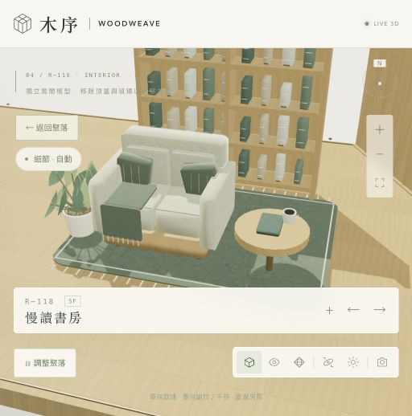

# 木序 WOODWEAVE — 九層菱形聚落

[開啟 3D 互動展示](https://rolanthhuang.github.io/WOODWEAVE/) · [容量測試紀錄](TEST_REPORT.md)

9 層斜向堆疊的木質多面體建築。中段房間最多，頂部及底部收窄，樓層中心逐層向右偏移，形成向上斜升的立體菱形。保留四面體、五面體、六面體房間與各房不同的科技極簡內裝。Atelier 03 將精細家具、木纖維板與羊毛氈材質套用到所有房間。

初始 180 間，1F 至 9F 分布為 **4 / 10 / 20 / 32 / 44 / 32 / 20 / 12 / 6**。可在 36–360 間之間向外重複生長，始終維持九層與第五層最多的分布。不是一次建立無限幾何。

[查看完整負載測試與畫面驗證](TEST_REPORT.md)

## 操作

- 拖曳旋轉；滾輪或加減鍵縮放；右鍵或 Shift 拖曳平移。
- 單指旋轉，雙指縮放與平移；窄視窗將房間資訊縮成底部橫列。
- 選擇「建築外觀」「打開剖面」或「支撐骨架」。骨架模式可清楚辨認兩側支柱、中央核心及轉換桁架。
- 點選九層分布圖，單獨檢視該層；「顯示全部」恢復九層。
- 調整「樓層展開」拆開模型。展開時會隱藏連續骨架，屬於拆解觀看示意。
- 點選房間或使用左右箭頭，再按「走進這個房間」查看內裝。
- 單房內可按「近看家具與材質」或專屬裝置的「近看」。資訊卡會收合，按「＋」可展開。
- 「細節」面板提供自動、極致、輕盈三種品質，並可執行 180／360 間負載測試。
- 支援軸測、俯瞰、自動環繞、日夜切換與圖片匯出。方向鍵旋轉；Home 返回全景；Escape 返回聚落。

## Atelier 03 的材質與細節

- **實木與木纖維**：帶毛孔凹凸及粗糙度差異的木紋、交錯拼接地板、圓角木家具；牆面使用顆粒纖維感的木纖維吸音板。
- **Wool felt 羊毛氈**：沙發、靠枕、椅墊、地毯及坐墊有獨立生成的交錯纖維、凹凸與柔和掠射光，地毯另有近看的短纖維與流蘇。床單保留不同的細織紋。
- **八種生活配置**：分塊沙發軟墊與垂掛織物、床組層次與床頭分板、開放書櫃與書脊、餐盤與杯口、茶具、鍵盤按鍵、控制螢幕、桌燈、細葉植栽、黃銅五金及嵌條。
- **每房獨立裝置**：精修底座、藏光、固定件與刻度，以一張共用圖集提供各房不同的實體編號銘牌。
- 所有紋理在裝置本機生成，無外部材質下載。材質是即時繪圖的程序化表現，並非實測材料掃描。

**自動**依畫面中房間的大小調整曲面細分與微小零件；進入單房會顯示完整細節。**極致**會在整棟同時顯示全部微小零件；360 間的房間模型約有 800 萬個三角形，實際畫面另包含基座與骨架。**輕盈**降低繪圖解析度、遠景曲面及微小零件。相同幾何和材質共用，以實例批次合併繪圖；閒置時停止連續繪圖。

內建測試依序量測 180 間自動、360 間自動、360 間極致外觀、360 間極致剖面、單房材質近看、24 次換房與四次增建切換。每組先暖機 3 秒，再量測約 20 秒。紀錄平均 FPS、95／99 百分位的畫格間隔、超過 50 ms 的畫格、繪製次數、三角形與已配置的繪圖資源數。提交時間是 CPU 提交繪圖指令的時間；不是 GPU 執行時間。瀏覽器未提供 JS heap 時以 `null` 記錄，JS heap 也不是整個程序或 GPU 的記憶體。

短測試可檢查此次視窗中是否流暢及出現顯示中斷，不代表長時間溫度、電池、全裝置容量或記憶體上限的保證。

## 每房專屬特色

每間房都有一件獨立生成、可在單房檢視辨識的焦點裝置。九個設計家族包含光譜浮雕、星環燈、稜晶庭、波紋屏、軌道雕塑、螺旋光階、數位山水、星圖光牆與稜鏡收藏架。同一家族的構成、角度、數量、波形或排列也會不同，另有六個高度編碼單元，確保族內裝置的幾何不重複。

每件裝置有獨立名稱與說明，顯示於房間資訊卡。180 間與 360 間上限皆檢查過特色識別與名稱不重複。這是參數化生成的獨立設計，而非手工繪製 360 套不同設計家族；部分房間會共享用途或裝置家族。

## 支撐構想與驗證界線

設計中加入 **兩根側向巨柱**，各自落在基座上，並用最寬樓層附近的深桁架連接中央核心。逐層梁系、外側連續斜肋及中央核心，呈現由樓層向地面的荷載傳遞構想。表面保留木材語彙，轉換桁架與拉桿採木包覆／鋼構混合概念。

這是可視化的結構概念，**尚未進行承載驗算**。模型不是有限元素、剛體力學或施工設計；連接的幾何、九層分布與兩根側柱的存在可以檢查，但不能據此聲稱兩柱已足以承受自重、使用荷載、風力、地震、扭轉、撓度或接頭作用。梁柱、接點及基礎尺寸仍需依材料、跨度、地質與所在地法規由結構設計決定。

構想依據是連續荷載路徑：

- [FEMA／PNNL：從屋頂到基礎的連續荷載路徑](https://basc.pnnl.gov/resource-guides/continuous-load-path-provided-connections-roof-through-wall-foundation)
- [WoodWorks：CLT 懸挑及點支承系統的彎曲、剪力與支承考量](https://www.woodworks.org/resources/design-strategies-for-two-way-spanning-cross-laminated-timber/)

## 檔案與幾何

所有執行資源均在 `dist/`，沒有外部字型、分析追蹤、帳號或 API 依賴。根目錄 `index.html` 是可直接開啟的自含式展示頁，適合 GitHub Pages。可編輯模組保存在 `dist/`；以靜態網頁伺服器開啟 `dist/index.html`，或使用合併的 `dist/standalone.html`。單檔合併與檢查可分別執行 `node build-standalone.mjs`、`node verify.mjs`。Three.js r170 採 MIT 授權，授權檔位於 `dist/vendor/THREE-LICENSE.txt`。

四面體是三角錐，五面體是三角柱，六面體是菱形柱。相鄰兩個三角網格可合成菱形房間。房間細部分板及窗框不另計為主多面體面數。面積是幾何底面面積。各房間以固定種子產生用途、材質、色彩、家具尺度與位置；增建不會重設既有房間的配置。
