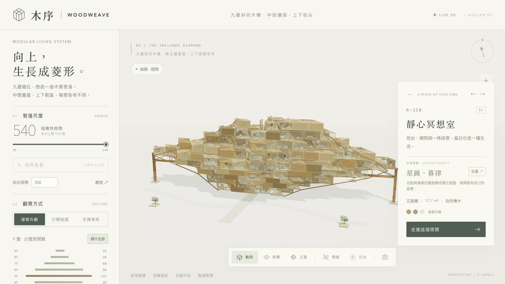
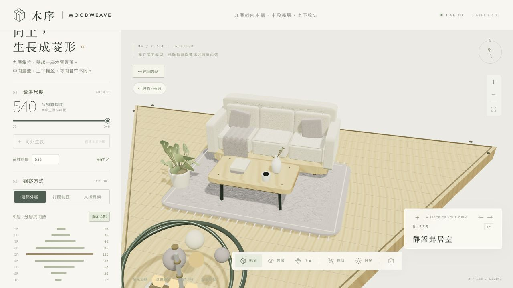
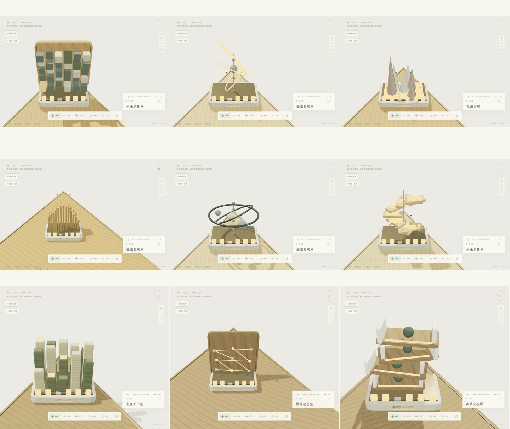

# Atelier 05 · 540 間精修版驗證

2026-10-15，Apple M4 Pro、24 GB 記憶體，本機 Codex 桌面瀏覽器。**發布上限 540 間，九層菱形輪廓保留。八組觀看測試通過。** 原有 1,080 種房間的生成設計庫仍保留，並逐房檢查精修模型與實際幾何差異。

## 本輪提升

- 木材與 Wool felt 各有 **2048 × 2048** 色彩、法線、粗糙度貼圖；木纖維吸音材、細織布、端面木紋各為 **1024 × 1024**。色彩採 sRGB，法線與粗糙度採非色彩資料。
- 單房增加曲面細分、立體包邊、針腳、木作接合、端面、五金、按房形裁切的板縫、垂墜披毯與流蘇。披毯法線平滑處理。每房有 **2,494–3,224 段**纖維、縫線或刻紋，設計庫中最多 **207,848 個三角形**。
- 九類裝置各自增加加工細節、由房間種子決定的雕刻輪廓及排列。近看銘牌為 **1024 × 320**。比對家具與裝置的幾何、變換及顏色，排除銘牌編號後，1,080 個設計仍各不相同。
- 540 間使用樓層實例批次；靠近切換精修材質，單房使用精修幾何。單房最近使用快取上限 8 間，移除時釋放專用資源。較大生成場景的空間分區程式保留，但不是本版 540 間的批次方式。
- 修正四面體斜牆的可視判斷，專屬裝置聚焦時移開遮擋牆面；恢復全房時重新顯示。
- 所有紋理在本機生成，無外部材質或字型下載；屬程序化表現，並非實物掃描。

## 高解析度測試方式

固定 **1920 × 1080** CSS 排版，3D 區域外框 1617 × 1004，扣除邊框後實際 **1616 × 1004**；極致模式繪圖為 **3232 × 2008，倍率 2**。測試副本只固定兩處像素倍率輸入及排版尺寸，防止宿主調整視窗或響應式斷點改變量測負荷。幾何、材質、相機及測試程式和正式版相同；正式版保持響應式及原生 DPR，最高 2×。[方法、原始版與測試版雜湊](docs/atelier05-retina-method.json)。九組所有取樣畫格均維持 3232 × 2008。

一般場景暖機 3 秒，快速操作暖機 6 秒。全景近看與快速操作各量測 60 秒；快速操作每 0.8 秒交替拉遠／拉近，同時每秒旋轉 2.2 弧度。單房微距快速操作量測 30 秒。縮放過程與遠近材質切換均納入，固定極致品質。

門檻：平均至少 **45 FPS**、P99 畫格間隔不超過 **28 ms**、**零個 >50 ms 畫格**、**零次 WebGL 顯示中斷**。換房／模型重建另列。此環境觀察到更新上限約 50 FPS，沒有驗證 60／120 FPS。

| 場景 | 秒數 | 平均 FPS | P95 / P99 ms | 最慢 ms | >50 ms |
|---|---:|---:|---:|---:|---:|
| 540 間・極致全景 | 20.02 | 50 | 20.1 / 20.7 | 21 | 0 |
| 540 間・極致近景 | 60.02 | 50 | 20.1 / 20.8 | 21.1 | 0 |
| 540 間・快速旋轉與縮放 | 60 | 50 | 20.9 / 21 | 21.1 | 0 |
| 540 間・極致剖面 | 12.02 | 50 | 20.9 / 21 | 21 | 0 |
| 單房・材質近看 | 12.02 | 50 | 20.9 / 21 | 21 | 0 |
| 羊毛氈沙發與織物 | 12.04 | 50 | 20.9 / 21 | 21 | 0 |
| 稜晶裝置與加工細節 | 12.02 | 50 | 20.9 / 21 | 21.1 | 0 |
| 單房・快速旋轉與微距縮放 | 30.02 | 50 | 20.9 / 21 | 21 | 0 |
| 24 次換房與反覆增建 | 20.02 | 49.5 | 20.9 / 21 | 80.2 | 4 |

**八組觀看／鏡頭測試全部通過，顯示中斷 0 次。** 整棟快速操作切換遠近 76 次、轉動約 132 弧度，相機距離 12.63–193.12；單房切換 38 次、轉動約 66 弧度，相機距離 2.41–9.97。

24 次換房加四次 **360／540 間重建**的混合壓力測試，平均 49.5 FPS，出現四個 >50 ms 畫格，最慢 **80.2 ms**。因此不宣稱調整房間數及重建模型完全沒有短暫停頓。這組混合量測不能把每個慢畫格確切歸因到個別操作。快取各組取樣均為 8 間。

[完整發布版量測 JSON](docs/atelier05-performance-retina.json)

## 為何選擇 540 間

本輪優先保留近看質感、建築層次和快速觀看手感。1,080 間在不同輪次表現不一致：一輪通過後，另一輪近景平均 **36.1 FPS、P99 41 ms**，全景及快速操作也未達門檻，沒有只採用單次通過結果。720 間分區試跑的近景亦未達門檻，該輪提早停止，不視為完整九組測試。最後降至 540 間，合併成樓層批次，完成上表九組測試；精修材質與單房幾何未因減量而降低。

- [初版 1,080 間、近景未通過](docs/atelier05-before-spatial-batching.json)
- [1,080 間曾通過的一輪](docs/atelier05-1080-first-pass.json)
- [1,080 間後續未通過的一輪](docs/atelier05-1080-repeat.json)
- [720 間提早停止的試跑](docs/atelier05-720-trial.json)

上述輪次含批次方式及部分修正差異，不能解讀為單一變數的容量實驗。未量測裝置溫度、時脈、電池或 GPU 記憶體，因此不能確認較差輪次是否由發熱造成。540 是本版選定的展示上限，並非硬體理論容量。

## 資源與靜態檢查

測試初始已配置幾何資源 87 個、貼圖 31 張，結束取樣 117 個、39 張；各組結束取樣 JS heap **30.9–55.2 MB**。這些是資源數量及取樣值，不是峰值、程序總記憶體或 GPU 記憶體。全景最多約 700 次繪製、1,234 萬三角形。房間批次的靜態統計為 660 批、165,992 個實例、12,307,789 個三角形，不含全場景的基座／結構等其他繪圖。

靜態檢查覆蓋 1,080 個精修設計的有限座標、實際家具與裝置指紋；540 個發布房間、不同銘牌區域、選取覆蓋；36／72／180／216／360／540／720／1,080 間的生成；九層菱形、兩根側柱、穩定增建、三類多面體及自含單檔語法。[原始輸出](docs/atelier05-static-check.jsonl)。

發布版保留 **12 / 30 / 60 / 96 / 132 / 96 / 60 / 36 / 18** 的樓層分布，四／五／六面體分別 95／366／79 間。另以未修改正式單檔巡檢房號直達、單房近看、九類特色裝置、四面體遮擋修正、分層及整體展開。瀏覽器錯誤紀錄未見錯誤。

短時間單機量測不保證全裝置、長時間溫度、電池、記憶體洩漏或容量上限；畫格排程不是輸入至螢幕顯示延遲。結構承載維持 **NOT_ANALYSED**。[前版 Atelier 04 紀錄](ATELIER04_TEST_REPORT.md)。

