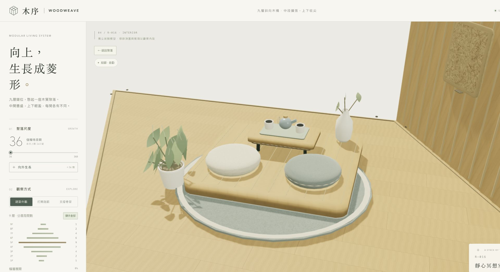
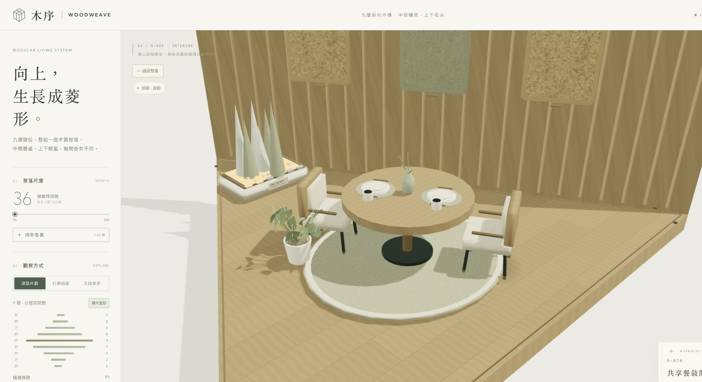

# Atelier 03 容量與畫面驗證

2026-10-15，以桌面瀏覽器實測。最終測試使用 1920 × 1080 的網頁視窗，其中 3D 區域／繪圖解析度為 **1617 × 1004，像素倍率 1**。先前也測試了 512 × 458 的窄視窗（極致繪圖 1024 × 916）。

每組先暖機 3 秒，再量測約 20 秒。以下為最終版本的原始紀錄摘要；平均 FPS 是瀏覽器畫格排程與繪圖過程的實際量測。

| 場景 | 平均 FPS | 畫格 P95 / P99 (ms) | >50 ms 畫格 | 最高繪製次數 | 最高三角形 | JS heap 取樣 (MB) |
|---|---:|---:|---:|---:|---:|---:|
| 180 間・自動全景 | 50 | 20.5 / 21.6 | 0 | 678 | 4,190,247 | 21.5 |
| 360 間・自動全景 | 50 | 20.1 / 21.6 | 0 | 689 | 8,074,192 | 41.3 |
| 360 間・極致全景 | 50 | 20.7 / 21.7 | 0 | 689 | 8,074,192 | 36.9 |
| 360 間・極致剖面 | 50 | 21.8 / 22 | 0 | 547 | 7,435,390 | 31.2 |
| 單房・材質近看 | 50 | 22 / 22 | 0 | 44 | 27,476 | 23.8 |
| 24 次換房與反覆增建 | 49.6 | 21.9 / 22 | 3 | 547 | 7,435,390 | 83 |

六組均完成，WebGL 顯示中斷 **0 次**，本次瀏覽器錯誤紀錄為空。反覆切換包含 **24 次換房、4 次 180／360 間重建**。360 間極致剖面的幾何資源為 51、貼圖為 16；完成切換後，同場景仍為 51／16。這是已配置繪圖資源的數量，不是 GPU 記憶體用量。

JS heap 在最終各組結束時取樣為 **21.5–83 MB**，最後重建後為 83 MB；取樣不是整段測試的峰值，垃圾回收時機也會影響讀數。未量測程序總記憶體、GPU 記憶體、裝置溫度或長時間洩漏，因此不據此宣稱沒有記憶體洩漏或所有裝置均不會過載。

180／360 間幾何重建的本次初始耗時約 37–95 ms。更換場景時仍可能發生短暫停頓；測試中的三個 >50 ms 畫格出現在反覆換房／增建階段。

另以實際畫面檢查八種用途：書房、臥室、工作室、創作室、交誼廳、起居室、冥想室、餐室。可辨識羊毛氈、木纖維板、木紋、分塊軟墊、五金、餐具、鍵盤及各房專屬裝置。前景牆面會依觀看方向開放，玻璃與窗框於單房觀察時移除。

幾何檢查涵蓋 36／72／180／216／360 間、九層菱形分布、兩根側柱、既有房間增建後不變、所有房間／特色／名稱不重複、三種多面體、有限座標及自含展示頁語法。360 間房間模型共有 649 個繪圖批次、110,426 個實例、8,049,317 個三角形；畫面另外包含骨架與景觀。

支撐屬概念模型，承載狀態仍為 `NOT_ANALYSED`。

[完整原始量測 JSON](docs/performance-fullhd.json)

